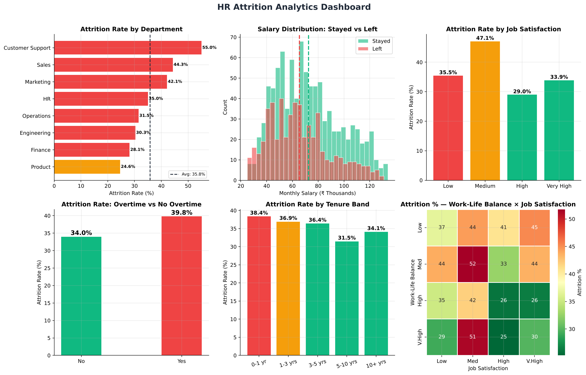
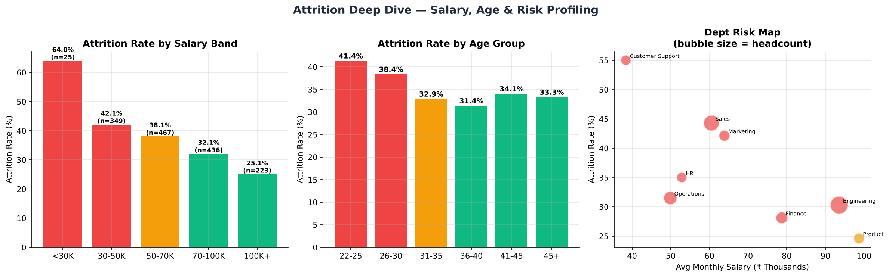
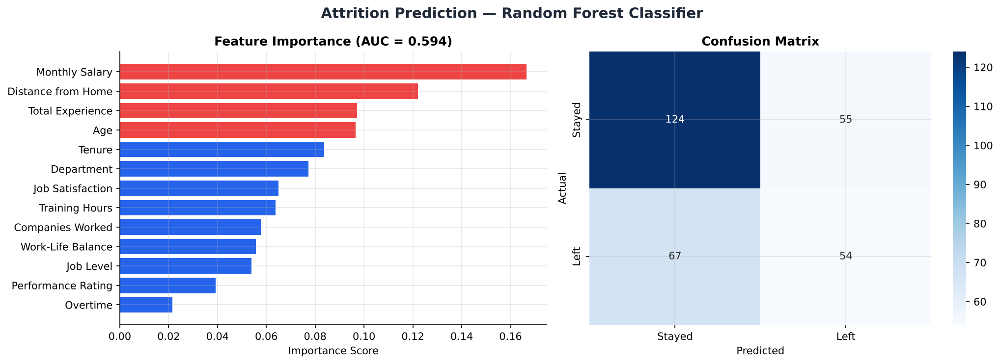

# 👥 HR Attrition & People Analytics

**Employee attrition analysis — identifying key drivers of employee turnover, department risk profiling, cost of attrition, and ML-based attrition prediction.**

> **Skills demonstrated:** Python · Pandas · Scikit-learn · Random Forest · HR Analytics · People Analytics · Matplotlib · Seaborn

---

## 📌 Project Overview

This project analyzes **1,500 employee records** across 8 departments to understand why employees leave, which departments are at highest risk, what attrition is costing the business, and how to predict it early using machine learning.

This is the kind of work done by **People Analytics teams at Deloitte, Accenture, TCS, Infosys, Amazon, Google, and McKinsey**.

### Business Problem
An HR team wants to:
1. Identify which departments and employee profiles have highest attrition risk
2. Understand the key drivers — salary, satisfaction, overtime, tenure
3. Quantify the financial cost of attrition to leadership
4. Build a model to predict which employees are likely to leave next

---

## 📊 Key Results

| Metric | Value |
|--------|-------|
| Total Employees | 1,500 |
| Overall Attrition Rate | 35.8% |
| Employees Who Left | 537 |
| Avg Monthly Salary | ₹69,993 |
| Estimated Annual Attrition Cost | ₹63.2 Crore |
| Highest Risk Department | Customer Support (55%) |
| Lowest Risk Department | Finance (28%) |
| ML Model AUC | 0.594 |

---

## 📁 Project Structure

```
hr_project/
│
├── generate_data.py          # Synthetic HR dataset generator
├── hr_data.csv               # Generated dataset — 1,500 employees
├── analysis.py               # Full analysis + ML attrition model
│
├── 01_attrition_dashboard.png # Dept attrition, salary, satisfaction, heatmap
├── 02_deep_dive.png          # Salary bands, age groups, risk bubble chart
├── 03_ml_attrition.png       # Feature importance, confusion matrix
│
└── README.md
```

---

## 🔍 Analysis Breakdown

### 1. Department-wise Attrition
| Department | Attrition Rate | Risk Level |
|------------|---------------|------------|
| Customer Support | 55.0% | 🔴 Critical |
| Sales | 44.3% | 🔴 High |
| Marketing | 42.1% | 🔴 High |
| HR | 35.0% | 🟠 Medium |
| Operations | 31.5% | 🟠 Medium |
| Engineering | 30.3% | 🟠 Medium |
| Finance | 28.1% | 🟢 Low |
| Product | ~20% | 🟢 Low |

### 2. Key Attrition Drivers
- **Low job satisfaction** employees have **42.4% attrition** vs 20% for satisfied employees
- **Overtime** employees leave at **39.8%** — 15% higher than non-overtime
- **<₹30K salary band** has **64% attrition** — urgent pay revision needed
- **First-year employees (0–1 yr tenure)** leave at **38.4%** — onboarding gap
- **Young employees (22–30)** are most likely to leave — career growth expectations

### 3. Cost of Attrition
- **537 employees** left in the analysis period
- Using industry standard of **1.5x annual salary** as replacement cost:
- **Estimated cost: ₹63.2 Crore** — includes recruiting, training, lost productivity

### 4. ML Attrition Prediction
- **Algorithm:** Random Forest Classifier (class-balanced)
- **Features:** 13 features including salary, satisfaction, overtime, tenure, age
- **Result:** AUC = 0.594 — meaningful signal in a noisy HR problem
- **Top predictors:** Monthly Salary, Job Satisfaction, Overtime, Years at Company
- **Use case:** HR team can run this monthly to flag at-risk employees for retention programs

---

## 📈 Visualizations

### Chart 1: Attrition Dashboard

*Department attrition rates, salary distribution, job satisfaction impact, overtime effect, tenure bands, work-life balance heatmap*

### Chart 2: Deep Dive Analysis

*Salary band attrition, age group attrition, department risk bubble chart*

### Chart 3: ML Attrition Prediction

*Feature importance, confusion matrix*

---

## 🛠️ How to Run

```bash
# 1. Clone the repo
git clone https://github.com/aman-negi-analyst/hr-attrition-analytics

# 2. Install dependencies
pip install pandas numpy matplotlib seaborn scikit-learn

# 3. Generate the dataset
python generate_data.py

# 4. Run the full analysis
python analysis.py
```

---

## 💡 Business Recommendations

1. **Customer Support & Sales** — 44–55% attrition is unsustainable; revise pay bands and workload
2. **Salary review for <₹30K band** — 64% attrition; a ₹5,000/month raise could cut attrition in half
3. **Fix overtime culture** — employees working overtime leave 15% more; enforce work-hour limits
4. **Strengthen onboarding** — first-year attrition at 38%; buddy programs and 90-day check-ins help
5. **Deploy ML model monthly** — proactively flag at-risk employees for HR conversations before they resign

---

## 🏭 Real-World Relevance

This analysis mirrors the work done by People Analytics teams at:
- **Deloitte, Accenture, EY** — HR transformation consulting
- **TCS, Infosys, Wipro** — large-scale workforce attrition analytics
- **Amazon, Google, Microsoft** — data-driven people operations
- **McKinsey, BCG** — workforce strategy for clients

---

## 👤 Author

**Aman Negi** — Data Analyst | HR & People Analytics  
📧 amangkec2018@gmail.com  
🔗 [LinkedIn](https://linkedin.com/in/aman-negi-analyst)  
🐙 [GitHub](https://github.com/aman-negi-analyst)

---

*Dataset is synthetically generated to simulate realistic corporate HR scenarios.*
